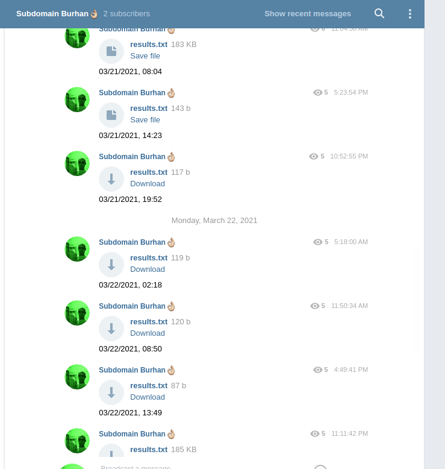

# Subdomain Takeover Automation

A cron-driven pipeline that looks for possible subdomain takeovers across the scopes of public bug bounty programs and posts what it finds to a Telegram channel. It is for bug bounty hunters who want takeover checks to run unattended.

> **Status:** archived. Built in 2021. Kept for reference, not maintained.

This is a tool for authorized security testing. Use it only against systems you own or are allowed to test, such as targets in the scope of a bug bounty program you take part in.

It ran every 6 hours for about a month. Every finding it reported in that time turned out to be invalid, so treat its output as leads to verify by hand, not as confirmed vulnerabilities.



## What it does

- Pulls the latest public bug bounty scopes from [bounty-targets-data](https://github.com/arkadiyt/bounty-targets-data) and turns its wildcard entries (`*.example.com`) into a list of root domains.
- Enumerates the subdomains of every domain with [subfinder](https://github.com/projectdiscovery/subfinder).
- Checks all collected subdomains for takeover with [subjack](https://github.com/haccer/subjack) and its fingerprint list.
- Drops results tagged `[SHOPIFY]`, `[FASTLY]` or `[TUMBLR]` to cut noise from outdated fingerprints.
- Sends whatever is left to a Telegram chat as a `results.txt` file, captioned with the time of the run.

## How it works

A subdomain takeover happens when someone gains control over a subdomain of a target domain, typically a forgotten one that still points at a service nobody claims anymore. The pipeline covers the three steps of finding one:

1. **Find target domains.** `test.sh` runs `git pull` on a local clone of bounty-targets-data and reads its `wildcards.txt`, which lists the wildcard scopes of public bug bounty programs.
2. **Enumerate subdomains.** Enumeration is slow, and Go tools handle it better than Python ones, so it uses subfinder, a fast passive subdomain enumeration tool.
3. **Check for takeover.** subjack scans the subdomain list concurrently and flags the ones that can be claimed. It was picked over [SubOver](https://github.com/Ice3man543/SubOver) because it was more up to date, but it still flags some services that are no longer vulnerable, hence the filter in `main.py`.

For which services can actually be taken over, see [can-i-take-over-xyz](https://github.com/EdOverflow/can-i-take-over-xyz).

## Tech stack

- Bash (`test.sh`) and cron
- Python 3 with pyTelegramBotAPI (`main.py`)
- subfinder and subjack (Go)
- bounty-targets-data as the target source

## Running it locally

The scripts were written for one Ubuntu server and use hardcoded paths, so adjust them before running.

1. Install [subfinder](https://github.com/projectdiscovery/subfinder) and [subjack](https://github.com/haccer/subjack) so their binaries are in `~/go/bin/`. `test.sh` reads subjack's `fingerprints.json` from `/home/ubuntu/src/github.com/haccer/subjack/`.
2. Clone bounty-targets-data into `~/subdomain_takeover/bounty-targets-data`.
3. Install the Telegram library: `pip install pyTelegramBotAPI`.
4. In `main.py`, replace the `YOUR-BOT-TOKEn` and `YOUR-CHAT-ID` placeholders with your bot token and chat ID.
5. Put `test.sh` and `main.py` where the scripts expect them (`/home/ubuntu/`), or change the paths. Results are written to `/home/ubuntu/results.txt`.
6. Schedule it, for example every 6 hours:

```
0 */6 * * *  /home/ubuntu/test.sh
```

## References

- [How To Setup an Automated Sub-domain Takeover Scanner for All Bug Bounty Programs in 5 Minutes](https://hakluke.medium.com/how-to-setup-an-automated-sub-domain-takeover-scanner-for-all-bug-bounty-programs-in-5-minutes-3562eb621db3) (the main inspiration)
- [Subdomain Takeover: Basics](https://0xpatrik.com/subdomain-takeover-basics/) and more on [0xpatrik.com](https://0xpatrik.com/)
- [Subdomain Takeovers, beyond the basics for Pentesters and Bug Bounty Hunters](https://www.youtube.com/watch?v=q_A8aXLO1gA) (video)
- [MDN: Subdomain takeover](https://developer.mozilla.org/en-US/docs/Web/Security/Attacks/Subdomain_takeover)
- [HackerOne: A Guide To Subdomain Takeovers](https://www.hackerone.com/blog/guide-subdomain-takeovers)
- [Detectify Labs: Hostile subdomain takeover using Heroku/Github/Desk](https://labs.detectify.com/writeups/hostile-subdomain-takeover-using-heroku-github-desk-more/)

## License

MIT, see [LICENSE](LICENSE).
